# Arcade Skins for Manic EMU

Quick heads-up on the page layout and the 2.0.2 change:

- Using Manic EMU 2.0.2 or newer? Use the regular releases (v1.0 to v1.6), the ones without “Legacy” in the name.
- Using Manic EMU 2.0.1 or earlier (for example a sideloaded copy)? Use the Legacy releases. They’re the old sets, unchanged.
- What changed: only the button numbering. Manic 2.0.2 changed the button inputs, so I patched every set to match. In the updated sets the buttons now read 1, 2, 3 on the top row and 4, 5, 6 below, left to right (right to left on the left-handed sets). The Legacy sets use the old numbering, where Button 1 is at the bottom right. Using the wrong set for your version gives scrambled inputs.
- Tekken-Rival Fix is retired. With the new numbering, the regular 4 Button works for Tekken and Rival Schools in my testing. The old Tekken-Rival Fix skins are still in the Legacy releases for 2.0.1.
- Twin Stick skins work on both versions. In my testing they play the same, and the Legacy copies are identical.
- iPad skins: All iPad sets work on both Manic EMU versions, with one exception: the iPad Street Fighter set uses a special button order and is only compatible with the Legacy mapping. iPad users should use the regular releases for all other layouts.
- The README and release pages are still being updated. I’ll add a Legacy section and move the outdated info there.
- The Links below will take you to the page you need for both 2.0.2 [new sets] and to 2.0.1 [Legacy sets]

**[⬇ Download the skins (latest release)](https://github.com/TheMameKing/manic-emu-arcade-skins/releases/latest)**

| Sets | Manic EMU 2.0.2 or newer| Manic EMU 2.0.1 and earlier |
|---|---|---|
| **Original set** | [v1.0](https://github.com/TheMameKing/manic-emu-arcade-skins/releases/tag/V1.0) |  [Legacy-v1.0](https://github.com/TheMameKing/manic-emu-arcade-skins/releases/tag/Legacy-v1.0) |
| **Dynamic Island** | [v1.1](https://github.com/TheMameKing/manic-emu-arcade-skins/releases/tag/v1.1) |[Legacy-v1.1](https://github.com/TheMameKing/manic-emu-arcade-skins/releases/tag/Legacy-v1.1)  |
| **Tate (vertical games)** | [v1.2](https://github.com/TheMameKing/manic-emu-arcade-skins/releases/tag/v1.2) |  [Legacy-v1.2](https://github.com/TheMameKing/manic-emu-arcade-skins/releases/tag/Legacy-v1.2) |
| **Left-Handed set** |  [v1.3](https://github.com/TheMameKing/manic-emu-arcade-skins/releases/tag/v1.3) | [Legacy-v1.3](https://github.com/TheMameKing/manic-emu-arcade-skins/releases/tag/Legacy-v1.3)|
| **iPad set** | [v1.4](https://github.com/TheMameKing/manic-emu-arcade-skins/releases/tag/v1.4) | [Legacy-v1.4](https://github.com/TheMameKing/manic-emu-arcade-skins/releases/tag/Legacy-v1.4) |
| **D-Pad set** | [v1.5](https://github.com/TheMameKing/manic-emu-arcade-skins/releases/tag/v1.5) | [Legacy-v1.5](https://github.com/TheMameKing/manic-emu-arcade-skins/releases/tag/Legacy-v1.5) |
| **Left-Handed D-Pad set** | [v1.6](https://github.com/TheMameKing/manic-emu-arcade-skins/releases/tag/v1.6) | [Legacy-v1.6](https://github.com/TheMameKing/manic-emu-arcade-skins/releases/tag/Legacy-v1.6) |
| **Extras** | [Extras](https://github.com/TheMameKing/manic-emu-arcade-skins/releases/tag/extras) |[Legacy-Extras](https://github.com/TheMameKing/manic-emu-arcade-skins/releases/tag/Legacy-Extras) |
| **Starter Packs** | [Starter-pack](https://github.com/TheMameKing/manic-emu-arcade-skins/releases/tag/Starter-Packs) | [Legacy-Starter-pack](https://github.com/TheMameKing/manic-emu-arcade-skins/releases/tag/Legacy-Starter-Packs) |

Original-art controller skins for **MAME / arcade** games in Manic EMU. 16 layouts, 22 colorways each: **352 skins in 48 zip files**. There is also a separate **Dynamic Island set** for iPhone 14 Pro and later, a **Tate set** for vertical games, a **Left-Handed set** that mirrors the Dynamic Island and Tate layouts, and an **iPad set**, a **D-Pad set** (including a Tate D-Pad set and a Left-Handed D-Pad set), and **Starter Packs** with one zip per set (see below).

All art is original. No real arcade characters, logos or game artwork appear on any skin.

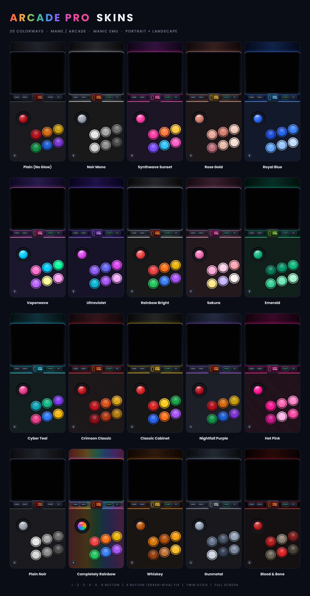

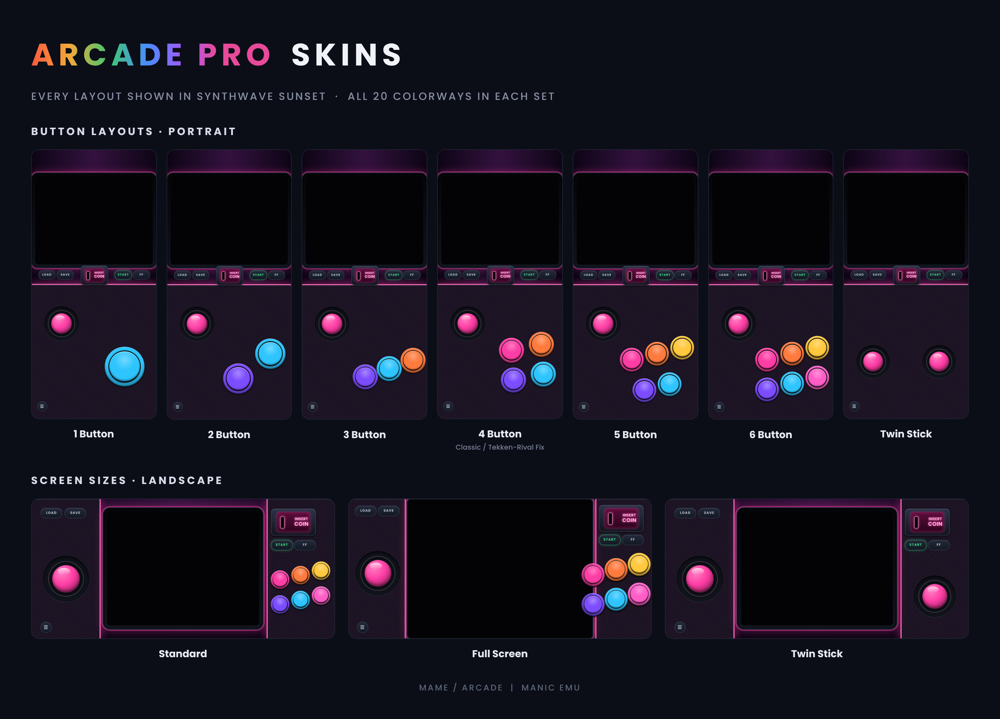

## Quick start

1. Open the **[Releases](../../releases)** page and download the zips you want.
2. Unzip them (on iPhone, tap the zip in the Files app). Each zip holds up to 10 `.manicskin` files.
3. Import the `.manicskin` files into Manic EMU with its skin import option, then pick the skin for your arcade games.

## Starter Packs (Nightfall Purple)

Not sure where to start? Each Starter Pack is one zip with every layout of a set in our flagship color, Nightfall Purple. They are copies of the same skins in the full sets, so nothing changes if you add a full set later.

Packs: Original (16), Dynamic Island (16), Left-Handed (21, includes the Left-Handed Tate layouts), Tate (5), iPad (23), D-Pad Original (14), D-Pad Dynamic Island (14), Tate D-Pad (4), D-Pad Left-Handed (19, includes the Tate D-Pad layouts and Tate D-Pad Only).

Download from the [Starter Packs release](https://github.com/TheMameKing/manic-emu-arcade-skins/releases/tag/Starter-Packs). To install, tap Assign Skin, New Skin, Open File, pick the pack zip and confirm. If that doesn't work, unzip it in the Files app first and select the .manicskin files instead. On older iOS versions you may need to unzip first.

Starter Packs for the Extras styles are available on DeltaStyles only. The full Extras zips are in the [Extras release](https://github.com/TheMameKing/manic-emu-arcade-skins/releases/tag/extras).

## Which zip do I need?

Every layout comes in two looks and three parts:

- **Normal** ("Pro"): the controls sit around the game screen.
- **Full Screen**: the game fills the screen, and in landscape the buttons are drawn see-through on top of it.
- **Part 1 / Part 2 / Part 3**: the 22 colorways are split across three zips of up to 10, so grab all parts for the full set.

| Layout | What it has | Download these |
|---|---|---|
| **1 Button** | Button 1 | `1 Button Zip` / `1 Button Full Screen Zip` |
| **2 Button** | Buttons 1-2 | `2 Button Zip` / `2 Button Full Screen Zip` |
| **3 Button** | Buttons 1-3 | `3 Button Zip` / `3 Button Full Screen Zip` |
| **4 Button Classic** | Buttons 1-4 | `4 Button Classic Zip` / `4 Button Classic Full Screen Zip` |
| **4 Button Tekken-Rival Fix** | Buttons 1-4, plus extra inputs on the bottom-left button (see below) | `4 Button Tekken-Rival Fix Zip` / `4 Button Tekken-Rival Fix Full Screen Zip` |
| **5 Button** | Buttons 1-5 | `5 Button Zip` / `5 Button Full Screen Zip` |
| **6 Button** | Buttons 1-6 | `6 Button Zip` / `6 Button Full Screen Zip` |
| **Twin Stick** | Two thumbsticks, no center buttons | `Twin Stick Zip` / `Twin Stick Full Screen Zip` |

Each name above comes as `... - Part 1.zip` and `... - Part 2.zip` (10 colorways each), plus `... - Part 3.zip` (Soft Light and Blackout).

## Dynamic Island set (iPhone 14 Pro and later)

On iPhones with a Dynamic Island, the island sits on the left or right edge in landscape and can cover controls. This separate set moves the controls clear of it. **If your phone has an older notch or no island, use the regular skins above.**

- Same 8 layouts, same button mapping, and the same Normal and Full Screen looks.
- In landscape, controls stay out of the island zone on both sides. Portrait is unchanged.
- Standard (non-Full Screen) skins have a slightly smaller game screen (about 6% smaller) to make room.
- Names include "Dynamic Island", so they install next to the regular skins without clashing.
- Island placement is estimated from published phone specs. Tested on an iPhone XR and an iPhone 17 Pro. If you try one on another Dynamic Island iPhone, a landscape screenshot would be very welcome.

It has 22 colorways: the same 20, plus **Soft Light** (off-white, no neon) and **Blackout** (dark body, dark buttons). That makes 352 skins in 48 zips.

| Layout | Download these |
|---|---|
| **1 Button** | `1-Button Dynamic Island Zip` / `1-Button Dynamic Island Full Screen Zip` |
| **2 Button** | `2-Button Dynamic Island Zip` / `2-Button Dynamic Island Full Screen Zip` |
| **3 Button** | `3-Button Dynamic Island Zip` / `3-Button Dynamic Island Full Screen Zip` |
| **4 Button Classic** | `4-Button Classic Dynamic Island Zip` / `4-Button Classic Dynamic Island Full Screen Zip` |
| **4 Button Tekken-Rival Fix** | `4-Button Tekken-Rival Fix Dynamic Island Zip` / `4-Button Tekken-Rival Fix Dynamic Island Full Screen Zip` |
| **5 Button** | `5-Button Dynamic Island Zip` / `5-Button Dynamic Island Full Screen Zip` |
| **6 Button** | `6-Button Dynamic Island Zip` / `6-Button Dynamic Island Full Screen Zip` |
| **Twin Stick** | `Twin Stick Dynamic Island Zip` / `Twin Stick Dynamic Island Full Screen Zip` |

Each name comes as `... - Part 1.zip` and `... - Part 2.zip` (10 colorways each), plus `... - Part 3.zip` (Soft Light and Blackout).

## Classic or Tekken-Rival Fix?

Both are 4-button layouts. They look the same and can be installed side by side.

- **Classic**: the bottom-left button is Button 2 only. Use this for most 4-button games.
- **Tekken-Rival Fix**: the bottom-left button sends Button 2 **and** Buttons 5 and 6 together. Some fighting games (Rival Schools wants Button 5, Tekken 3 wants Button 6) need those extra buttons, and this gives them to you without a 6-button layout.

## Tate (vertical game) skins

Vertical games like Galaga, 1942 or Ketsui are rotated upright by Manic EMU, but the game is stretched to fill the skin's screen. These skins have a tall 3:4 screen, so vertical games look the way they should. They work in portrait and landscape, and the controls stay clear of the Dynamic Island. For horizontal games, use the sets above.

| Layout | Good for | Download these |
|---|---|---|
| **1 Button** | Galaga, Pac-Man, Dig Dug, Donkey Kong | `Tate 1 Button Zip` |
| **2 Button** | 1942, Xevious, Raiden, Twin Cobra | `Tate 2 Button Zip` |
| **3 Button** | Ketsui, Mushihimesama, Battle Garegga, Batsugun | `Tate 3 Button Zip` |
| **4 Button** | Dai-Fukkatsu and other four-button shooters | `Tate 4 Button Zip` |
| **Twin Stick** | Smash TV style two-stick games | `Tate Twin Stick Zip` |

It has the same 22 colorways: 110 skins in 15 zips. Each name comes as `... - Part 1.zip` and `... - Part 2.zip` (10 colorways each), plus `... - Part 3.zip` (Soft Light and Blackout).

**Prefer a D-pad?** There is a Tate D-pad version of these layouts for fast-turn games like Pac-Man and 1942: 1-4 Button, 22 colorways each, 88 skins in 12 zips. iPhone only; no Twin Stick or iPad versions. A left-handed version is in the [Left-Handed D-Pad set](#left-handed-d-pad-set-iphone). See [Tate D-Pad](#tate-d-pad-set-iphone) in the D-Pad section.

## Left-Handed set (mirrored layouts)

The stick is on the right, and the buttons are on the left, with Coin, Start and FF above them. The button mapping is the same as the regular skins. In landscape the controls stay clear of the Dynamic Island on both sides. Names include "Left-Handed", so they install next to the other sets.

It covers two of the sets above: the **Dynamic Island set** (16 layouts, Standard and Full Screen) and the **Tate set**. It has the same 22 colorways: 462 skins in 63 zips.

Looking for a left-handed D-pad? See the [Left-Handed D-Pad set](#left-handed-d-pad-set-iphone), which is a separate release.

| Layout | Download these (Dynamic Island) | Download these (Tate) |
|---|---|---|
| **1 Button** | `1-Button Dynamic Island Left-Handed Zip` / `... Full Screen Left-Handed Zip` | `Tate 1 Button Left-Handed Zip` |
| **2 Button** | `2-Button Dynamic Island Left-Handed Zip` / `... Full Screen Left-Handed Zip` | `Tate 2 Button Left-Handed Zip` |
| **3 Button** | `3-Button Dynamic Island Left-Handed Zip` / `... Full Screen Left-Handed Zip` | `Tate 3 Button Left-Handed Zip` |
| **4 Button Classic** | `4-Button Classic Dynamic Island Left-Handed Zip` / `... Full Screen Left-Handed Zip` | `Tate 4 Button Left-Handed Zip` |
| **4 Button Tekken-Rival Fix** | `4-Button Tekken-Rival Fix Dynamic Island Left-Handed Zip` / `... Full Screen Left-Handed Zip` | not available |
| **5 Button** | `5-Button Dynamic Island Left-Handed Zip` / `... Full Screen Left-Handed Zip` | not available |
| **6 Button** | `6-Button Dynamic Island Left-Handed Zip` / `... Full Screen Left-Handed Zip` | not available |
| **Twin Stick** | `Twin Stick Dynamic Island Left-Handed Zip` / `... Full Screen Left-Handed Zip` | `Tate Twin Stick Left-Handed Zip` |

Each name comes as `... - Part 1.zip` and `... - Part 2.zip` (10 colorways each), plus `... - Part 3.zip` (Soft Light and Blackout). **Twin Stick:** the movement stick is on the right and the fire stick on the left.

## iPad set (Handheld, Tabletop and Full Screen)

**For iPad only.** On an iPad, an iPhone skin looks squished and some buttons may not send the right inputs, even though Manic 2.0.2 lets iPads load iPhone skins. Use these skins on iPad and the other sets on iPhone.

Handheld and Tabletop have a 4:3 screen on top with the controls in a panel below. Full Screen fills the whole iPad screen in landscape, with see-through controls on top. Download them from the [v1.4 release](https://github.com/TheMameKing/manic-emu-arcade-skins/releases/tag/v1.4).

| Handheld, portrait | Handheld, landscape |
|---|---|
| 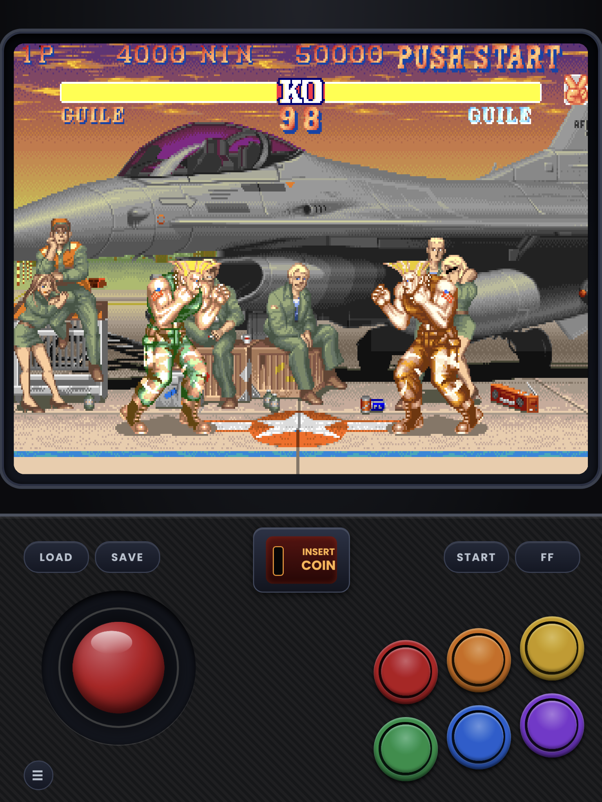 | 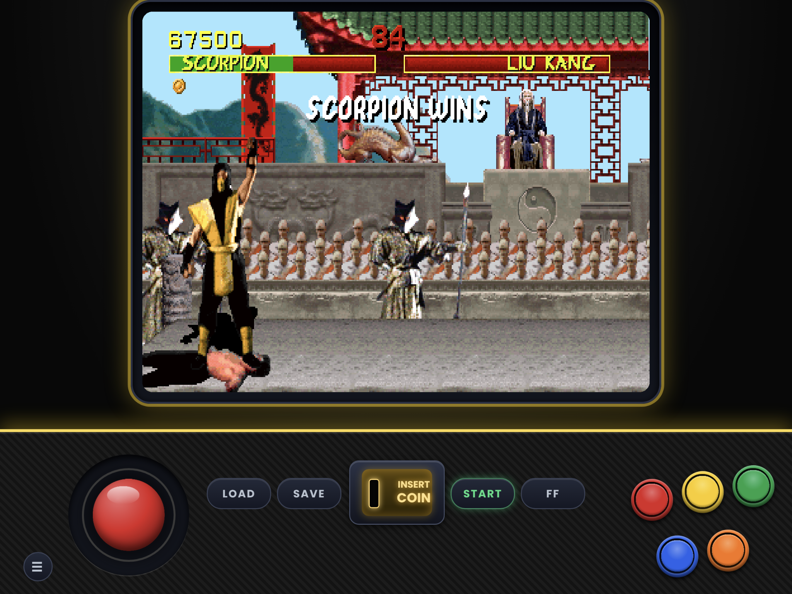 |

| Tabletop, landscape | Twin Stick, landscape |
|---|---|
| 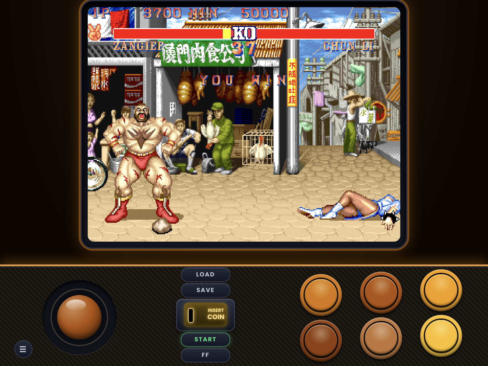 | 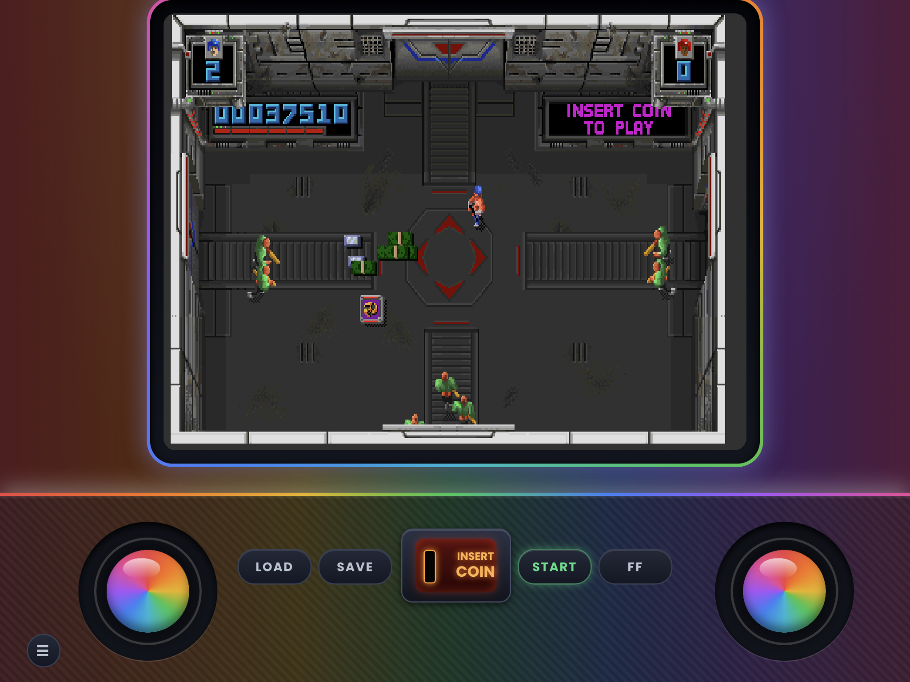 |

| Full Screen, landscape |
|---|
| 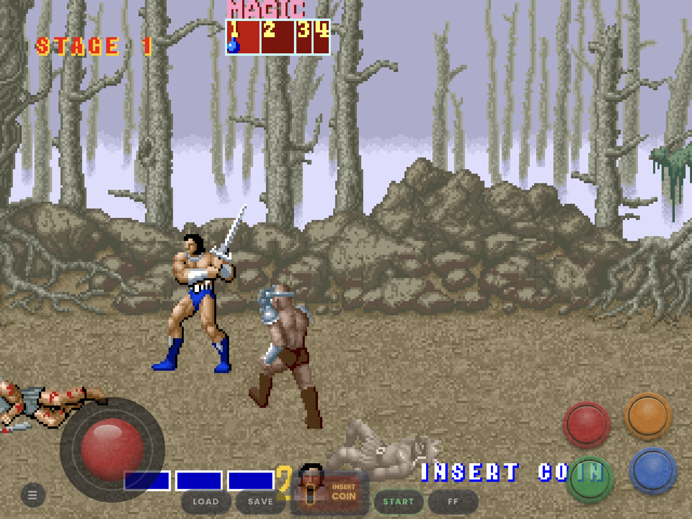 |

- **Full Screen**: the game fills the whole iPad screen in landscape, with see-through controls on top. Same button layout as Handheld. Portrait is the same as Handheld.
- **Handheld**: smaller buttons, closer together and in the bottom-right corner, for holding the iPad.
- **Tabletop**: bigger buttons with wider spacing, for when the iPad is lying flat.
- **Twin Stick**: one set for Handheld and Tabletop, and a separate Full Screen version.
- **Button order**: On iPad, the 1, 2 and 3 button layouts run Button 1, 2, 3 from left to right. On iPhone, the 2 button layout is Button 2, 1 and the 3 button layout is Button 2, 1, 3. The 4, 5 and 6 button layouts follow the Button order diagram below on both.
- **6 Button Street Fighter**: top row punches, bottom row kicks. Use it for Street Fighter style fighters.
- There is no Tekken-Rival Fix on iPad. The plain 4 Button works for Tekken and Rival Schools there.

It has the same 22 colorways: 506 skins in 69 zips.

| Layout | Download these |
|---|---|
| **1 Button** | `iPad 1 Button Handheld Zip` / `iPad 1 Button Tabletop Zip` / `iPad 1 Button Full Screen Zip` |
| **2 Button** | `iPad 2 Button Handheld Zip` / `iPad 2 Button Tabletop Zip` / `iPad 2 Button Full Screen Zip` |
| **3 Button** | `iPad 3 Button Handheld Zip` / `iPad 3 Button Tabletop Zip` / `iPad 3 Button Full Screen Zip` |
| **4 Button** | `iPad 4 Button Handheld Zip` / `iPad 4 Button Tabletop Zip` / `iPad 4 Button Full Screen Zip` |
| **5 Button** | `iPad 5 Button Handheld Zip` / `iPad 5 Button Tabletop Zip` / `iPad 5 Button Full Screen Zip` |
| **6 Button** | `iPad 6 Button Handheld Zip` / `iPad 6 Button Tabletop Zip` / `iPad 6 Button Full Screen Zip` |
| **6 Button Street Fighter** | `iPad 6 Button Street Fighter Handheld Zip` / `iPad 6 Button Street Fighter Tabletop Zip` / `iPad 6 Button Street Fighter Full Screen Zip` |
| **Twin Stick** | `iPad Twin Stick Zip` / `iPad Twin Stick Full Screen Zip` |

Each name comes as `... - Part 1.zip` and `... - Part 2.zip` (10 colorways each), plus `... - Part 3.zip` (Soft Light and Blackout).

**Tested on:** iPad mini (5th generation), iOS 15.6, Manic EMU 2.0.1 and 2.0.2. Other iPads should fit, but they're untested. If you try one, please [open an issue](../../issues) with a screenshot.

**Full Screen tested with:** 1942, Breakers Revenge, Contra, Ghosts 'n Goblins, Golden Axe, Joust, Mortal Kombat, Pang, Rival Schools, The Simpsons, Street Fighter II (and Champion Edition), Tekken 3, Turf Masters and Waku Waku 7.

## D-Pad set (alternative to the joystick)

**For iPhone. There is no iPad D-pad set yet.**

Same layouts, same button mapping and same colorways as the regular skins, but the joystick is replaced by a **D-pad** (up, down, left, right, with diagonals). A D-pad gives precise 4 and 8 direction input for fighting games (Street Fighter, Tekken), Pac-Man style games and anything where you don't want a stray up (jump) while mashing buttons. The D-pad is drawn in each colorway's accent color, so it is easy to tell from the joystick skins. Every D-pad skin includes invisible overshoot arms: slide off the pad in a straight line and the direction stays held. There is also a Tate D-pad set and a Left-Handed D-pad set, described below. Download all the D-pad skins from the [v1.5 release](https://github.com/TheMameKing/manic-emu-arcade-skins/releases/tag/v1.5).

It comes in two flavors, each with Normal and Full Screen looks:

- **Original**: for "notch" iPhones. 22 colorways.
- **Dynamic Island**: controls kept clear of the island. 22 colorways.

For Original and Dynamic Island: layouts 1, 2, 3, 4 (Classic and Tekken-Rival Fix), 5 and 6 Button. There is no Twin Stick D-pad set.

| Original, Full Screen landscape | Dynamic Island, Full Screen landscape |
|---|---|
| 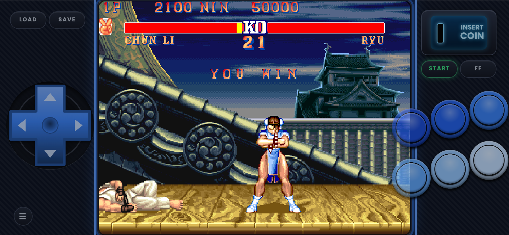 | 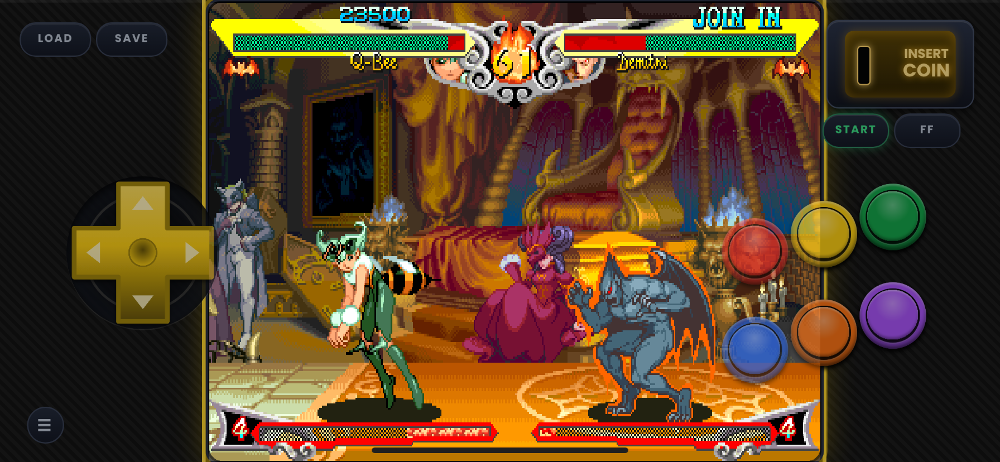 |

| Portrait |
|---|
| 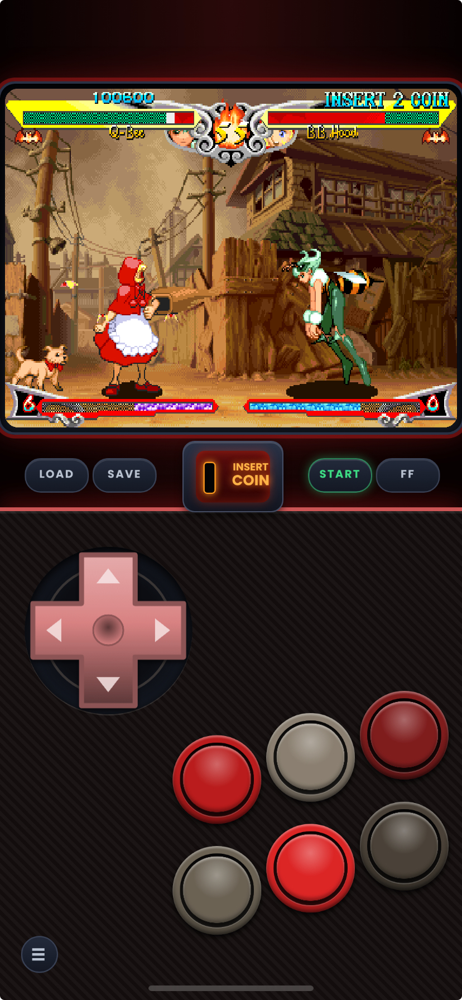 |

Portrait looks the same in Normal and Full Screen.

That makes 616 skins in 84 zips (308 in 42 zips for Original, 308 in 42 zips for Dynamic Island).

| Layout | Original | Dynamic Island |
|---|---|---|
| **1 Button** | `1-Button D-Pad Zip` / `1-Button D-Pad Full Screen Zip` | `1-Button D-Pad Dynamic Island Zip` / `... Full Screen Zip` |
| **2 Button** | `2-Button D-Pad Zip` / `2-Button D-Pad Full Screen Zip` | `2-Button D-Pad Dynamic Island Zip` / `... Full Screen Zip` |
| **3 Button** | `3-Button D-Pad Zip` / `3-Button D-Pad Full Screen Zip` | `3-Button D-Pad Dynamic Island Zip` / `... Full Screen Zip` |
| **4 Button Classic** | `4-Button Classic D-Pad Zip` / `... Full Screen Zip` | `4-Button Classic D-Pad Dynamic Island Zip` / `... Full Screen Zip` |
| **4 Button Tekken-Rival Fix** | `4-Button Tekken-Rival Fix D-Pad Zip` / `... Full Screen Zip` | `4-Button Tekken-Rival Fix D-Pad Dynamic Island Zip` / `... Full Screen Zip` |
| **5 Button** | `5-Button D-Pad Zip` / `5-Button D-Pad Full Screen Zip` | `5-Button D-Pad Dynamic Island Zip` / `... Full Screen Zip` |
| **6 Button** | `6-Button D-Pad Zip` / `6-Button D-Pad Full Screen Zip` | `6-Button D-Pad Dynamic Island Zip` / `... Full Screen Zip` |

Each name comes as `... - Part 1.zip` and `... - Part 2.zip` (10 colorways each), plus `... - Part 3.zip` (Soft Light and Blackout).

**Tested on:** iPhone XR and iPhone 17 Pro, Manic EMU 2.0.1

### Tate D-Pad Set (iPhone)

A D-pad version of the Tate (vertical) skins, built for games where fast turns matter, like Pac-Man, 1942 and other vertical shooters and mazes. The accent-colored cross replaces the stick, and the buttons keep the same order as the stick Tate skins.

**What's included**
- Tate 1, 2, 3 and 4 Button, each in 22 colorways (88 skins)
- 12 zips: "Tate N Button D-Pad Zip - Part 1 / 2 / 3". Parts 1 and 2 hold the colorways, and Part 3 holds Soft Light and Blackout.
- iPhone only. No Twin Stick or iPad versions of these yet. A left-handed version is in the [Left-Handed D-Pad set](#left-handed-d-pad-set-iphone).

8-way D-pad: diagonals work, so it handles fast turns and diagonal movement smoothly.

Tested on iPhone XR with Manic EMU 2.0.1.

Download from the [v1.5 release](https://github.com/TheMameKing/manic-emu-arcade-skins/releases/tag/v1.5), with the other D-pad skins.

For Pac-Man style games with no action buttons, see Tate D-Pad Only (left- and right-handed) in the [Extras](#extras) section.

### Left-Handed D-Pad Set (iPhone)

The D-pad skins mirrored for left-handed play: the D-pad is on the right and the buttons are on the left, with the same button mapping and 22 colorways as the right-handed D-pad set. Start then FF, and Load then Save, run left to right across the top, as in the other sets. Every skin includes the invisible overshoot arms.

It covers the **Dynamic Island** style (Standard and Full Screen) and the **Tate D-Pad** layouts. There is no Original (notch) version of the left-handed D-pad yet, no Twin Stick, and no iPad version. That makes **396 skins in 54 zips** (18 layouts). Download them from the [v1.6 release](https://github.com/TheMameKing/manic-emu-arcade-skins/releases/tag/v1.6).

| Layout | Dynamic Island | Tate |
|---|---|---|
| **1 Button** | `1-Button D-Pad Dynamic Island Left-Handed Zip` / `... Full Screen Left-Handed Zip` | `Tate 1-Button D-Pad Left-Handed Zip` |
| **2 Button** | `2-Button D-Pad Dynamic Island Left-Handed Zip` / `... Full Screen Left-Handed Zip` | `Tate 2-Button D-Pad Left-Handed Zip` |
| **3 Button** | `3-Button D-Pad Dynamic Island Left-Handed Zip` / `... Full Screen Left-Handed Zip` | `Tate 3-Button D-Pad Left-Handed Zip` |
| **4 Button Classic** | `4-Button Classic D-Pad Dynamic Island Left-Handed Zip` / `... Full Screen Left-Handed Zip` | `Tate 4-Button D-Pad Left-Handed Zip` |
| **4 Button Tekken-Rival Fix** | `4-Button Tekken-Rival Fix D-Pad Dynamic Island Left-Handed Zip` / `... Full Screen Left-Handed Zip` | not available |
| **5 Button** | `5-Button D-Pad Dynamic Island Left-Handed Zip` / `... Full Screen Left-Handed Zip` | not available |
| **6 Button** | `6-Button D-Pad Dynamic Island Left-Handed Zip` / `... Full Screen Left-Handed Zip` | not available |

Each name comes as `... - Part 1.zip` and `... - Part 2.zip` (10 colorways each), plus `... - Part 3.zip` (Soft Light and Blackout). For left-handed Pac-Man style games with no buttons, see Tate D-Pad Only in the [Extras](#extras) section.

## Extras

Special-purpose skins and extra styles that don't belong to the main sets. They're in the [Extras release](https://github.com/TheMameKing/manic-emu-arcade-skins/releases/tag/extras).

### Combo skins

Some fighting games use button combinations that are hard to press on a touch screen. Combo skins add labelled combo buttons next to the normal ones. They have their own three colorways, so they're easy to tell apart from the other sets.

**4-Button Tekken-Rival Combo** (Dynamic Island, Standard and Full Screen): the 4 Button Tekken-Rival Fix layout, plus two combo buttons.

- **1+2**: presses the top-right and bottom-left buttons together. Tekken: grab. Rival Schools: special attack.
- **3+4**: presses the two bottom buttons together. Tekken and Rival Schools: dodge.

Colorways: Combo Gold, Combo Neon, Combo Ember. 6 skins in 2 zips. Download from the [Extras release](https://github.com/TheMameKing/manic-emu-arcade-skins/releases/tag/extras): `4-Button Tekken-Rival Combo Dynamic Island`, `4-Button Tekken-Rival Combo Dynamic Island Full Screen`

| Skin | Combo buttons | What they do | Tested |
|---|---|---|---|
| 4-Button Tekken-Rival Combo | 1+2, 3+4 | Tekken 3: grab, dodge. Rival Schools: special attack, dodge | Rival Schools, Tekken 3 |

Combos differ from game to game, so skins made for a specific game are named after it and added over time.

**Want a combo skin for a game that isn't listed?** [Open a combo request](../../issues/new?template=combo-request.md) with the game name and the combos you need.

### Tate D-Pad Only (iPhone)

Big D-pad skins for vertical games with no action buttons, like Pac-Man and Ms. Pac-Man. One large D-pad plus Coin, Start, FF, Load, Save and menu. Centered in portrait, on the left in landscape. There is also a left-handed version that puts the D-pad on the right. Portrait is the same in both.

- 22 colorways, 22 skins in 3 zips: `Tate D-Pad Only Zip - Part 1 / 2 / 3`. Part 3 holds Soft Light and Blackout.
- 22 colorways, 22 skins in 3 zips: `Tate D-Pad Only Left-Handed Zip - Part 1 / 2 / 3`. Part 3 holds Soft Light and Blackout.
- 8-way D-pad. iPhone only.
- Need a fire button? Use the Tate D-Pad set in the [v1.5 release](https://github.com/TheMameKing/manic-emu-arcade-skins/releases/tag/v1.5) or the Tate D-Pad Left-Handed set in [v1.6](https://github.com/TheMameKing/manic-emu-arcade-skins/releases/tag/v1.6).

Tested on iPhone XR with Manic EMU 2.0.1.

### Twin Stick Balanced

A second twin-stick style with the sticks side by side instead of staggered. The original staggered set is unchanged.

- 176 skins in 24 zips, 8 layouts, 22 colorways each.
- Layouts: Pro, Full Screen, Dynamic Island and Dynamic Island Full Screen, plus Tate. Dynamic Island, Dynamic Island Full Screen and Tate also come in Left-Handed versions.
- Left-handed versions swap the sticks and buttons, with Start then FF and Load then Save across the top.

| Layout | Download these |
|---|---|
| **Pro** | `Twin Stick Balanced Pro Zip` |
| **Full Screen** | `Twin Stick Balanced Full Screen Zip` |
| **Dynamic Island** | `Twin Stick Balanced Dynamic Island Zip` / `... Left-Handed Zip` |
| **Dynamic Island Full Screen** | `Twin Stick Balanced Dynamic Island Full Screen Zip` / `... Left-Handed Zip` |
| **Tate** | `Tate Twin Stick Balanced Zip` / `Tate Twin Stick Balanced Left-Handed Zip` |

Each name comes as `... - Part 1.zip` and `... - Part 2.zip` (10 colorways each), plus `... - Part 3.zip` (Soft Light and Blackout).

### Tate 3-Button Wide Spacing

A roomier Tate 3-Button layout for people who overshoot the stick or have bigger thumbs. The stick moved up and left and the buttons shifted right to give more space between your fingers.

- 44 skins in 6 zips, right- and left-handed, 22 colorways each: `Tate 3-Button Wide Spacing Zip - Part 1 / 2 / 3` and `Tate 3-Button Wide Spacing Left-Handed Zip - Part 1 / 2 / 3`.
- The standard Tate 3-Button set stays as it is.

## Button mapping

Manic EMU's arcade core numbers the buttons like this:

| Skin input | Arcade button |
|---|---|
| `b` | Button 1 |
| `a` | Button 2 |
| `y` | Button 3 |
| `x` | Button 4 |
| `l1` | Button 5 |
| `r1` | Button 6 |

This table describes the iPhone skins. The iPad skins send their inputs in a different order, but the buttons play the same as on the phone. See the diagram below for the layout.

A game that needs Buttons 1 to N needs every number from 1 to N present on the skin, which is why 1-Button uses `b` and 3-Button uses `a`, `b` and `y`.

**Twin Stick** has no center buttons. In Smash TV and Total Carnage, the right stick fires in 4 directions (the `x` / `y` / `a` / `b` inputs).

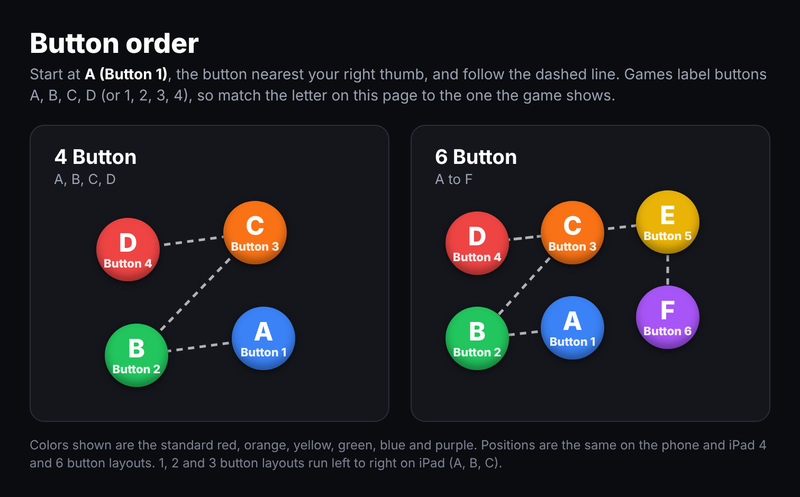

Button roles vary by game. For example, in Golden Axe the middle button on a phone 3 button skin is attack and the left is jump, while in Turf Masters the left button aims left, the middle shoots, and the right aims right. If a button does something unexpected, check the game's controller menu in Manic EMU, since the same button number can mean different things in different games.

**Prefer a sequential button layout?**
The button order follows Manic EMU's arcade mapping (see the Button order diagram above). If you'd rather have a plain Button 1, 2, 3 from left to right in every layout, open an [issue](../../issues) and let me know. If enough people ask, I'll consider an alternative set.

## The 22 colorways

Plain (No Glow), Noir Mono, Synthwave Sunset, Rose Gold, Royal Blue, Vaporwave, Ultraviolet, Rainbow Bright, Sakura, Emerald, Cyber Teal, Crimson Classic, Classic Cabinet, Nightfall Purple, Hot Pink, Plain Noir, Completely Rainbow, Whiskey, Gunmetal, Blood & Bone, plus **Soft Light** (off-white, no neon) and **Blackout** (dark body, dark buttons). All sets have all 22.

## Known issues

- 6 Button: Shadow Force 6 button is not confirmed, I can’t find a US version to test. 3 button works with world and Japan version

## For skin makers

Each `.manicskin` is a zip containing `info.json`, PNG art and PDF button images. The layout lives in `info.json` under `representations.iphone.edgeToEdge.{portrait, landscape}` (iPad skins use `representations.ipad.standard.{portrait, landscape}`):

- `assets.large`: PNG with a transparent hole where the game screen goes
- `items`: thumbsticks, D-pads and buttons. Each button has an `inputs` list, and a button can send several at once (for example `["a", "l1", "r1"]`)
- `mappingSize` and `screens[].outputFrame`: size and screen position
- `translucent`: `true` for Full Screen landscape, where buttons are drawn over the game
- D-pad items (D-Pad set) use an `inputs` object instead of a list: `{"up": "up", "down": "down", "left": "left", "right": "right"}`, with `asset.normal` pointing to the D-pad image (`dpad.pdf`)

## License

Made by **TheMameKing** and released under **CC BY 4.0** (see [LICENSE](LICENSE)). You can share and adapt the skins, including commercially, as long as you give credit.
