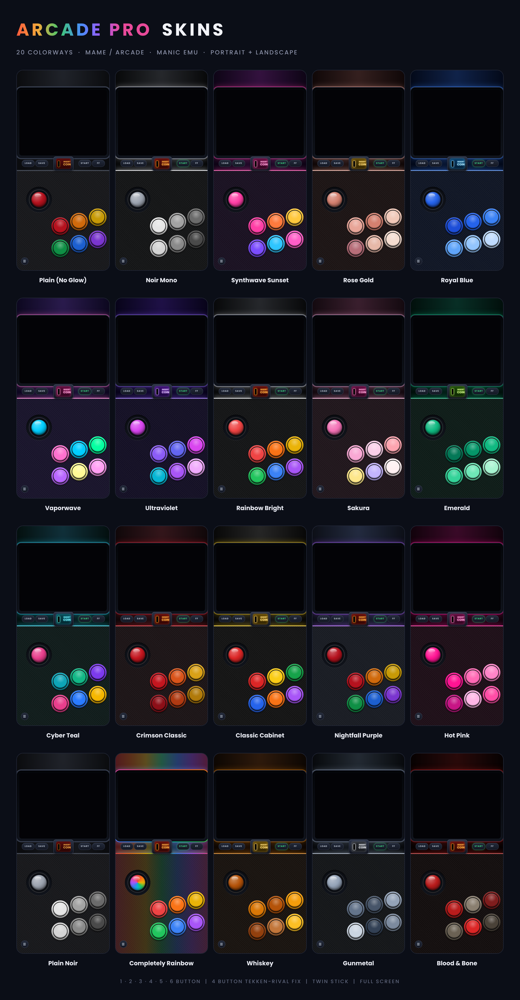
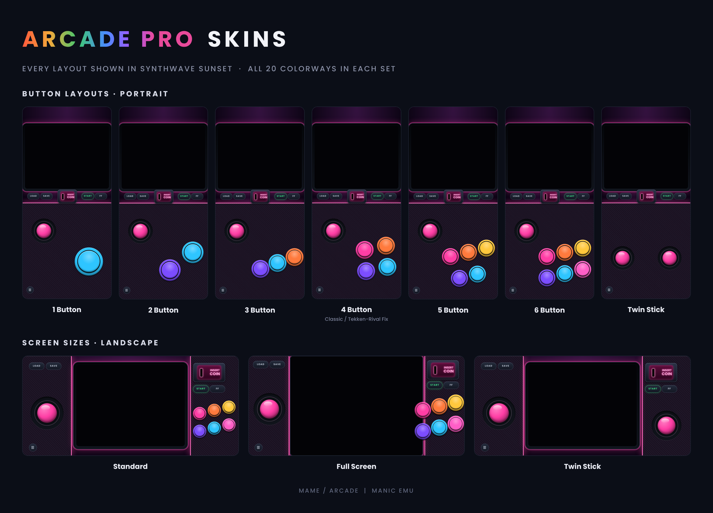

# Arcade Skins for Manic EMU

**[⬇ Download the skins (latest release)](https://github.com/TheMameKing/manic-emu-arcade-skins/releases/latest)**

Original set: [v1.0](https://github.com/TheMameKing/manic-emu-arcade-skins/releases/tag/V1.0) · Dynamic Island set: [v1.1](https://github.com/TheMameKing/manic-emu-arcade-skins/releases/tag/v1.1) · Tate (vertical games): [v1.2](https://github.com/TheMameKing/manic-emu-arcade-skins/releases/tag/v1.2)

Original-art controller skins for **MAME / arcade** games in Manic EMU. 16 layouts, 20 colorways each: **320 skins in 32 zip files**. There is also a separate **Dynamic Island set** for iPhone 14 Pro and later, and a **Tate set** for vertical games (see below).

All art is original. No real arcade characters, logos or game artwork appear on any skin.

## Quick start

1. Open the **[Releases](../../releases)** page and download the zips you want.
2. Unzip them (on iPhone, tap the zip in the Files app). Each zip holds up to 10 `.manicskin` files.
3. Import the `.manicskin` files into Manic EMU with its skin import option, then pick the skin for your arcade games.

## Which zip do I need?

Every layout comes in two looks and two parts:

- **Normal** ("Pro"): the controls sit around the game screen.
- **Full Screen**: the game fills the screen, and in landscape the buttons are drawn see-through on top of it.
- **Part 1 / Part 2**: the 20 colorways are split across two zips of 10, so grab both parts for the full set.

| Layout | What it has | Download these |
|---|---|---|
| **1 Button** | Button 1 | `1 Button Zip` / `1 Button Full Screen Zip` |
| **2 Button** | Buttons 1-2 | `2 Button Zip` / `2 Button Full Screen Zip` |
| **3 Button** | Buttons 1-3 | `3 Button Zip` / `3 Button Full Screen Zip` |
| **4 Button Classic** | Buttons 1-4 | `4 Button Classic Zip` / `4 Button Classic Full Screen Zip` |
| **4 Button Tekken-Rival Fix** | Buttons 1-4, plus extra inputs on the bottom-left button (see below) | `4 Button Tekken-Rival Fix Zip` / `4 Button Tekken-Rival Fix Full Screen Zip` |
| **5 Button** | Buttons 1-5 | `5 Button Zip` / `5 Button Full Screen Zip` |
| **6 Button** | Buttons 1-6 | `6 Button Zip` / `6 Button Full Screen Zip` |
| **Twin Stick** | Two thumbsticks, no center buttons | `Twin Stick Zip` / `Twin Stick Full Screen Zip` |

Each name above comes as `... - Part 1.zip` and `... - Part 2.zip`.

## Dynamic Island set (iPhone 14 Pro and later)

On iPhones with a Dynamic Island, the island sits on the left or right edge in landscape and can cover controls. This separate set moves the controls clear of it. **If your phone has an older notch or no island, use the regular skins above.**

- Same 8 layouts, same button mapping, and the same Normal and Full Screen looks.
- In landscape, controls stay out of the island zone on both sides. Portrait is unchanged.
- Standard (non-Full Screen) skins have a slightly smaller game screen (about 6% smaller) to make room.
- Names include "Dynamic Island", so they install next to the regular skins without clashing.
- Placement is based on published phone specs and tested on an iPhone XR. If you try one on a Dynamic Island iPhone, a landscape screenshot would be very welcome.

It has 22 colorways: the same 20, plus **Soft Light** (off-white, no neon) and **Blackout** (dark body, dark buttons). That makes 352 skins in 48 zips.

| Layout | Download these |
|---|---|
| **1 Button** | `1-Button Dynamic Island Zip` / `1-Button Dynamic Island Full Screen Zip` |
| **2 Button** | `2-Button Dynamic Island Zip` / `2-Button Dynamic Island Full Screen Zip` |
| **3 Button** | `3-Button Dynamic Island Zip` / `3-Button Dynamic Island Full Screen Zip` |
| **4 Button Classic** | `4-Button Classic Dynamic Island Zip` / `4-Button Classic Dynamic Island Full Screen Zip` |
| **4 Button Tekken-Rival Fix** | `4-Button Tekken-Rival Fix Dynamic Island Zip` / `4-Button Tekken-Rival Fix Dynamic Island Full Screen Zip` |
| **5 Button** | `5-Button Dynamic Island Zip` / `5-Button Dynamic Island Full Screen Zip` |
| **6 Button** | `6-Button Dynamic Island Zip` / `6-Button Dynamic Island Full Screen Zip` |
| **Twin Stick** | `Twin Stick Dynamic Island Zip` / `Twin Stick Dynamic Island Full Screen Zip` |

Each name comes as `... - Part 1.zip` and `... - Part 2.zip` (10 colorways each), plus `... - Part 3.zip` (Soft Light and Blackout).

## Classic or Tekken-Rival Fix?

Both are 4-button layouts. They look the same and can be installed side by side.

- **Classic**: the bottom-left button is Button 2 only. Use this for most 4-button games.
- **Tekken-Rival Fix**: the bottom-left button sends Button 2 **and** Buttons 5 and 6 together. Some fighting games (Rival Schools wants Button 5, Tekken wants Button 6) need those extra buttons, and this gives them to you without a 6-button layout.

## Tate (vertical game) skins

Vertical games like Galaga, 1942 or Ketsui are rotated upright by Manic EMU, but the game is stretched to fill the skin's screen. These skins have a tall 3:4 screen, so vertical games look the way they should. They work in portrait and landscape, and the controls stay clear of the Dynamic Island. For horizontal games, use the sets above.

| Layout | Good for | Download these |
|---|---|---|
| **1 Button** | Galaga, Pac-Man, Dig Dug, Donkey Kong | `Tate 1 Button Zip` |
| **2 Button** | 1942, Xevious, Raiden, Twin Cobra | `Tate 2 Button Zip` |
| **3 Button** | Ketsui, Mushihimesama, Battle Garegga, Batsugun | `Tate 3 Button Zip` |
| **4 Button** | Dai-Fukkatsu and other four-button shooters | `Tate 4 Button Zip` |

It has the same 22 colorways: 88 skins in 12 zips. Each name comes as `... - Part 1.zip` and `... - Part 2.zip` (10 colorways each), plus `... - Part 3.zip` (Soft Light and Blackout).

## Button mapping

Manic EMU's arcade core numbers the buttons like this:

| Skin input | Arcade button |
|---|---|
| `b` | Button 1 |
| `a` | Button 2 |
| `y` | Button 3 |
| `x` | Button 4 |
| `l1` | Button 5 |
| `r1` | Button 6 |

A game that needs Buttons 1 to N needs every number from 1 to N present on the skin, which is why 1-Button uses `b` and 3-Button uses `a`, `b` and `y`.

**Twin Stick** has no center buttons. In Smash TV and Total Carnage, the right stick fires in 4 directions (the `x` / `y` / `a` / `b` inputs).

## The 20 colorways

Plain (No Glow), Noir Mono, Synthwave Sunset, Rose Gold, Royal Blue, Vaporwave, Ultraviolet, Rainbow Bright, Sakura, Emerald, Cyber Teal, Crimson Classic, Classic Cabinet, Nightfall Purple, Hot Pink, Plain Noir, Completely Rainbow, Whiskey, Gunmetal, Blood & Bone. The Dynamic Island and Tate sets also have Soft Light and Blackout.

## Known issues

- 6 Button: Shadow Force does not work. Cause unknown.

## For skin makers

Each `.manicskin` is a zip containing `info.json`, PNG art and PDF button images. The layout lives in `info.json` under `representations.iphone.edgeToEdge.{portrait, landscape}`:

- `assets.large`: PNG with a transparent hole where the game screen goes
- `items`: thumbsticks and buttons. Each button has an `inputs` list, and a button can send several at once (for example `["a", "l1", "r1"]`)
- `mappingSize` and `screens[].outputFrame`: size and screen position
- `translucent`: `true` for Full Screen landscape, where buttons are drawn over the game

## License

Made by **TheMameKing** and released under **CC BY 4.0** (see [LICENSE](LICENSE)). You can share and adapt the skins, including commercially, as long as you give credit.
