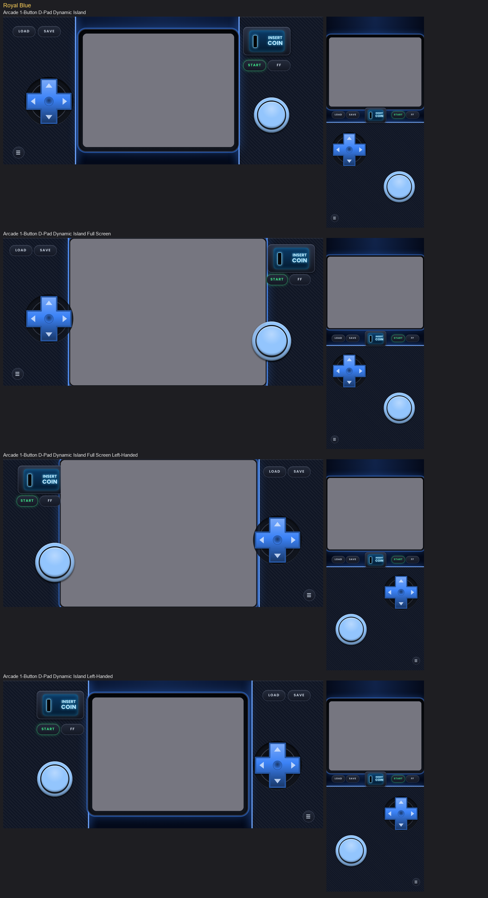

# Skin tools

Two small helper scripts for people making Manic EMU controller skins with `.manicskin` and `.deltaskin`. 

| File | What it does |
|---|---|
| `check_skin.py` | Sanity check: valid zip, `info.json`, every referenced file present, inputs, canvas bounds, duplicate identifiers. |
| `contact_sheet_easy.py` | Draws skins into pictures so you can compare layouts and colours by eye (phones and iPads). Supports `.manicskin` and `.deltaskin` |
| `FORMAT_NOTES.md` | Notes on the skin format and the button numbering. |


Both need Python 3 and Pillow (`pip install pillow`). `contact_sheet_easy.py` draws the real button artwork if you also install PyMuPDF (`pip install pymupdf`); without it the artwork is drawn as outlines.

## Important tips for easy use

| cmd | what it does|
|---|---|
  | --colours "all" |   which colourways to draw (default: all; names as in the skin file names) |
  | --orient both/landscape/portrait |  default both |
  | --rows 4 |                          layouts per picture (default 4); more layouts = more pictures |
  | --width 400 |                       width in pixels of each landscape tile (default 400); every tile is fitted in a box, so iPad skins are no longer cut off |
  | --out contact_sheets |              folder for the pictures (created if missing) |
  | --mode edgeToEdge / standard |        which Delta/Manic layout to draw when a skin has both (default: edgeToEdge, else standard) |
  | --boxes |                           outline every touch area and label it with its input (handy for Delta skins, whose buttons are painted into the background so there is no separate button artwork to draw) |
 | --compact |                        (always on for a PATH with many colourways; shown for completeness) leave out 'missing' tiles: each row shows only the colourways that exist for that layout, |


If you try and run these on a specific folder or `.manicskin | .deltaskin` loose file with spaces in the name it will fail to find the skin, they look for folder names as one word and its case sensitive. So if you try and run  `python contact_sheet_easy.py My skin folder --colours "Nightfall Purple"` it will fail to find it because of the space in the folder name or the `.manicskin | .deltaskin`. It needs to read like this or similar `python contact_sheet_easy.py My_skin_folder --colours "Nightfall Purple" ` and the folder itself needs to be named like that, it can be any name you like but it needs -_. something besides spaces, and it has to match the capitalization so if your folder is `My_Skin_Folder` you have to put that and not `my_skin_folder`. All these rules apply to the `.manicskin | .deltaskin` by itself also if you would rather check individual skins and not a folder, just put `My_purple_skin.manicskin` and not just `My_purple_skin`.

So my suggestion is if you want to make it easy and not rename the skin , just put it in a new folder or any folder in general then scan that folder with the .py since it'll scan every `.manicskin | .deltaskin` in the folder named in the cmd. You can also just put the scripts in the same folder as the `manicskin | folder-holding-the-manic-skin` or a copy of the skin if your worried (they are read-only and never change anything about the skin) and run the script with nothing after the `.py` in the cmd where the `zip/folder/skin` name would go if you wanted a specific skin. like this `python contact_sheet_easy.py` it also works on zipped skins, so if you have a zip full of skins it'll still read it.

```
python check_skin.py my_skins_folder | .manicskin | .deltaskin
python contact_sheet_easy.py my_skins_folder --colours "Blackout,Soft Light,Nightfall Purple"
python contact_sheet_easy.py

```

Run either with `--help` for all options. For a mixed folder (different layouts and colours), add `--compact` to `contact_sheet.py` to leave out empty slots. 

Another tip if you want a higher resolution use the `--width `setting, the higher the number, the higher the resolution. examples below.

`python contact_sheet_easy.py skin_folder --colours all --width 900 --rows 2` (this will give you a higher resolution than say `--width 300`) 

`python contact_sheet_easy.py skin_folder --colours "your color (ex. Nightfall Purple)" --compact` (use `--compact` if you have a variety of skins with different button counts and don't want to see empty slots, use this if you are looking at like lets say a variety pack set of skins from a multi colorway family set.

`python contact_sheet_easy.py skin_folder --colours all  --rows 200` (you can change the amount of rows there are in each sheet, so if you want to scan a large collection you can scan 200 on one sheet, idk the limit but i've done 224 on a sheet. Expect it to take a little bit of time with a giant collection. single and small sheets are near instant.

You can also open either of the scripts in notepad or similar app to see these options and more, and the list of errors and warnings for `check_skin.py` are in its script, these are here to make it easier to use. 

These tools are generic. They do not know the naming, colour or button-count rules of any particular collection.

## Preview
Running `contact_sheet.py` over a folder of skins writes numbered pictures to `contact_sheets/`:


<details>
<summary><b>More Sheet Examples </b></summary>

<br> 

**Sheet 1**



**Sheet 2**


**Sheet 3**


**Sheet 4**


**Sheet 5**


**Sheet 6**


</details>
Released under the MIT License, provided as-is with no warranty. The skins themselves are CC BY 4.0.
