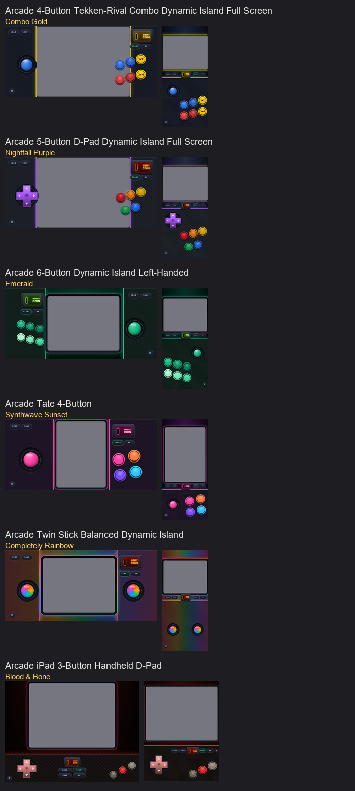

# Skin tools

Two small helper scripts for people making Manic EMU controller skins. They only read your skins and never change them.

| File | What it does |
|---|---|
| `check_skin.py` | Sanity check: valid zip, `info.json`, every referenced file present, inputs, canvas bounds, duplicate identifiers. |
| `contact_sheet.py` | Draws skins into pictures so you can compare layouts and colours by eye (phones and iPads). |
| `FORMAT_NOTES.md` | Notes on the skin format and the button numbering. |

Both need Python 3 and Pillow (`pip install pillow`). `contact_sheet.py` draws the real button artwork if you also install PyMuPDF (`pip install pymupdf`); without it the artwork is drawn as outlines.

```
python check_skin.py my_skins_folder
python contact_sheet.py my_skins_folder --colours "Blackout,Soft Light"
```

Run either with `--help` for all options. For a mixed folder (different layouts and colours), add `--compact` to `contact_sheet.py` to leave out empty slots.

## Preview
Running `contact_sheet.py` over a folder of skins writes numbered pictures to `contact_sheets/`:


.

These tools are generic. They do not know the naming, colour or button-count rules of any particular collection.


Released under the MIT License, provided as-is with no warranty. The skins themselves are CC BY 4.0.
