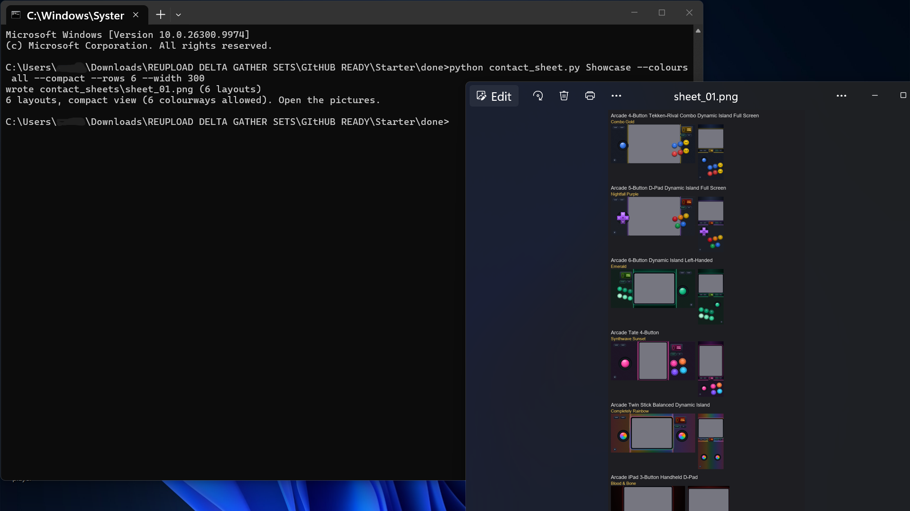
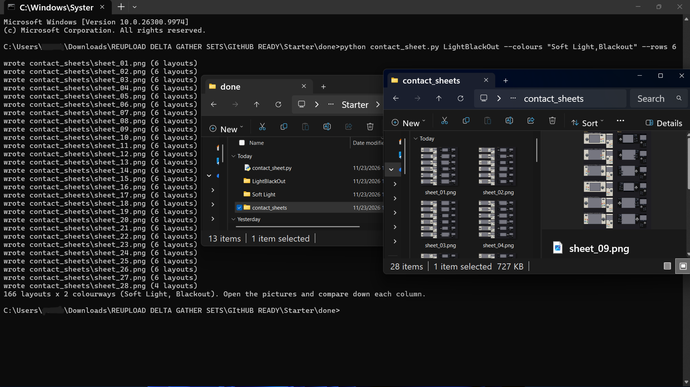
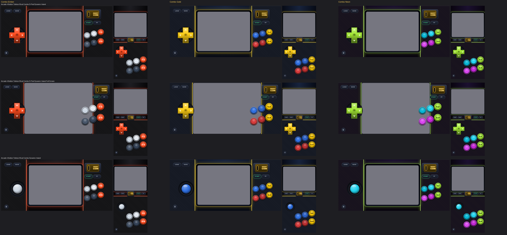
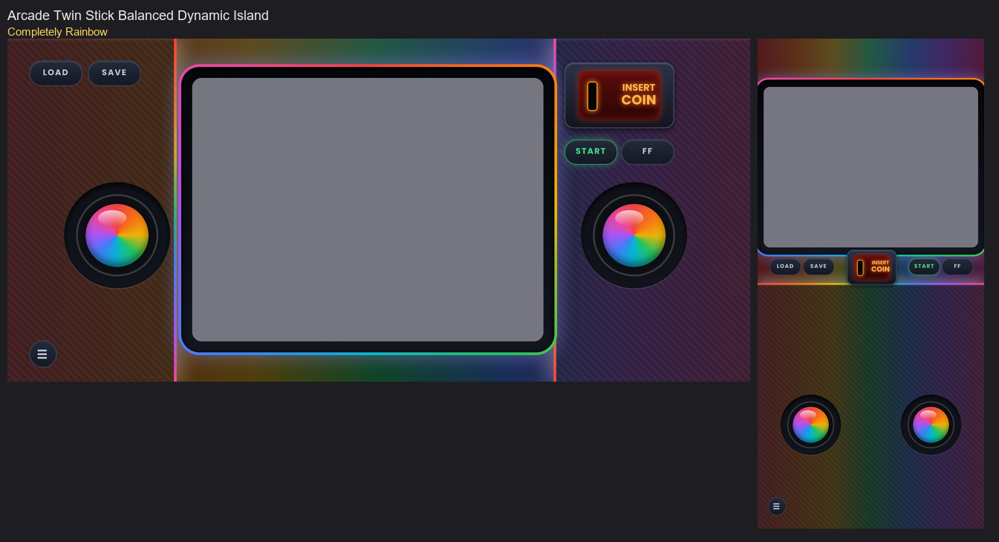

# Skin tools

A small collection of helper tools for people making Manic EMU controller skins. These tools support `.manicskin` and `.deltaskin` files, although support varies by tool.

 These tools are **Read-only** and do not modify your original skins. They only read the files and generate reports or contact sheets.

Currently, `contact_sheet_easy.py` supports both formats. I'm working on adding full `.deltaskin` support to `check_skin.py`

| File | What it does |
|---|---|
| `check_skin.py` | Sanity check: valid zip, `info.json`, every referenced file present, inputs, canvas bounds, duplicate identifiers. |
| `contact_sheet_easy.py` | Draws skins into pictures so you can compare layouts and colours by eye (phones and iPads). Supports `.manicskin` and `.deltaskin` |
| `FORMAT_NOTES.md` | Notes on the skin format and the button numbering. |


Both need Python 3 and Pillow (`pip install pillow`). `contact_sheet_easy.py` draws the real button artwork if you also install PyMuPDF (`pip install pymupdf`); without it the artwork is drawn as outlines.

## Usage and options

| option | what it does|
|---|---|
  | --colours "all" |   Selects which colourways to draw. Defaults to all available colourways. |
  | --orient both/landscape/portrait |  Selects which orientation to show. Defaults to both. |
  | --rows 4 |                          Sets the number of layouts per picture. More rows can reduce the number of output pictures. |
  | --width 400 |                       Sets the width of each landscape tile in pixels. Larger values produce higher-resolution pictures. |
  | --out contact_sheets |              Sets the output folder. Created automatically if it doesn't exist. |
  | --mode edgeToEdge / standard |      Selects which layout to draw when both are available. Defaults to edge-to-edge, otherwise standard. |
  | --boxes |                           Outlines touch areas and labels them with their inputs. Particularly useful for Delta skins. |
 | --compact |                        Leaves out missing layouts so each row only shows colourways that exist for that layout. |

Examples and explanations.
| cmd | why |
|--|---|
| python contact_sheet_easy.py "My Skin folder" --boxes |  ← This way works because of the quotes. |
| python contact_sheet_easy.py My Skin folder --boxes |   ← wrong, explained below this table | 
| python contact_sheet_easy.py My_Skin_folder --boxes | ← this way works without quotes if your folder has _.- instead of spaces |

----
 If a folder name contains spaces, put the entire folder name inside quotation marks. If it doesn't contain spaces, quotation marks aren't necessary.

Easy method — scan a folder: Put the skins you want to check into a folder, then run the script and give it that folder's name. It will scan the folder for supported skin files. 

You can also point the script directly at an individual `.manicskin` file or a supported skin folder.

Run without specifying a path: If you put the script in the same folder as the skins you want to scan, you can run it without adding a path: `python contact_sheet_easy.py` The script will use its default location.


```
python check_skin.py folder_name
# OR
python check_skin.py skin.manicskin
python contact_sheet_easy.py my_skins_folder --colours "Blackout,Soft Light,Nightfall Purple"
python contact_sheet_easy.py

```

Run either with `--help` for all options. For a mixed folder (different layouts and colours), add `--compact` to `contact_sheet_easy.py` to leave out empty slots. 

Another tip if you want a higher resolution use the `--width `setting, the higher the number, the higher the resolution. examples below.

Higher-resolution contact sheets
`python contact_sheet_easy.py skin_folder --colours all --width 900 --rows 2` Increase `--width` to produce larger, higher-resolution layout images. For example, `--width 900` produces wider tiles than `--width 300`.

Mixed collections
`python contact_sheet_easy.py skin_folder --colours "your color (ex. Nightfall Purple)" --compact` (use `--compact` when scanning collections with different layouts, button counts, or colourways. It removes empty slots so the results are easier to compare.

Large collections
`python contact_sheet_easy.py skin_folder --colours all  --rows 200` Increase `--rows` to fit more layouts into each contact sheet. I've successfully generated sheets containing 224 layouts, although larger collections may take longer to process.

You can also open either Python script in Notepad or another text editor to see the available options and additional information. The full list of errors and warnings reported by check_skin.py is documented inside the script.

**These tools are generic**. They check and display skin files without enforcing the naming conventions, colourway requirements, or button-count rules of any particular skin collection.. They are **Read Only** and do not modify or change the skins

## Preview
Running `contact_sheet.py` over a folder of skins writes numbered pictures to `contact_sheets/`:







<details>
<summary><b>More Sheet Examples </b></summary>

<br> 

**Sheet 1**


**Sheet 2**


**Sheet 3**



**Sheet 4**


**Sheet 5**



**Sheet 6**


</details>
Released under the MIT License, provided as-is with no warranty. The skins themselves are CC BY 4.0.
