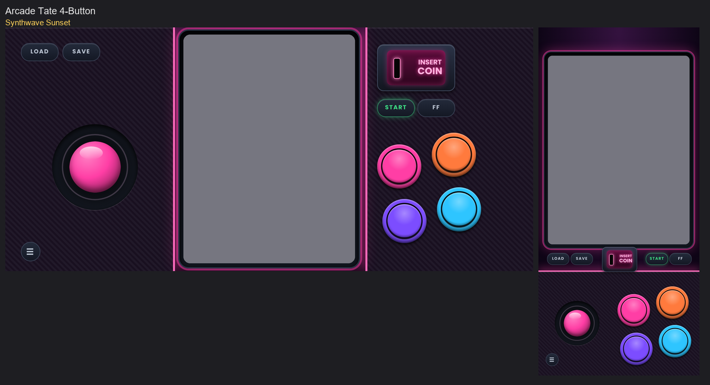
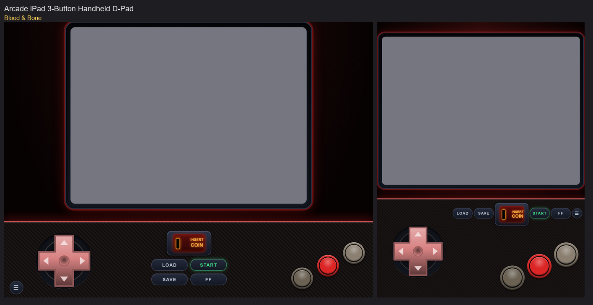

# Skin Tools

Two small helper scripts for people making Manic EMU controller skins. Both tools can read `.manicskin` and `.deltaskin` files, although support varies by tool. `contact_sheet_easy.py` fully supports both formats, while `check_skin.py` provides solid structural checks for both, with a few Delta-specific differences noted below. These tools used together compliment one another. 
Both tools are **read-only**. They never change your skins; they only read them and print a report or draw pictures.

| File | What it does |
|---|---|
| `check_skin.py` | Structural sanity check: valid zip, `info.json`, missing files, bad frames, controls off the canvas, unknown inputs, duplicate identifiers, misspelt keys, and more. Works on both Manic and Delta skins |
| `contact_sheet_easy.py` | Draws your skins as pictures so you can compare layouts and colours by eye. Phones and iPads. Fully supports both formats |
| `FORMAT_NOTES.md` | Notes on the skin format and button numbering. |

> `.deltaskin` support: `contact_sheet_easy.py` fully supports it. `check_skin.py` has a **basic** Delta check that is still being expanded to cover more skin types.

---

## Quick start

**1. Install (one time).** You need [Python 3](https://www.python.org/downloads/) and Pillow:

```
pip install pillow
pip install pymupdf # Optional: enables real PDF artwork rendering
```

`pymupdf` is optional. With it, the real button and stick artwork is drawn. Without it, they appear as outlines.

**2. Put your skins in a folder.** Loose `.manicskin` files, zips, or a folder of zips all work.

**3. Open a terminal in the folder that holds the scripts** and run one of these:

```
python check_skin.py my_skins
python contact_sheet_easy.py my_skins
```

On Mac and Linux, use `python3` instead of `python`.

The contact sheet pictures appear in a new `contact_sheets` folder from where you ran the command from

---

## Folder names with spaces

If a folder name has spaces, put it in quotes:

| Command | Works? |
|---|---|
| `python contact_sheet_easy.py "My Skin Folder"` | Yes. Quotes keep the name together. |
| `python contact_sheet_easy.py My_Skin_Folder` | Yes. No spaces, so no quotes needed. |
| `python contact_sheet_easy.py My Skin Folder` | **No.** The terminal sees three separate names. |

**Shortcut:** put the script inside the folder of skins and run it with no path. It scans the folder you are in:

```
python contact_sheet_easy.py
```

---

## check_skin.py

Prints a list of problems it finds. If a skin is fine, it prints nothing for that skin.

```
python check_skin.py my_skins
python check_skin.py MySkin.manicskin
python check_skin.py MySkin.deltaskin
```

You can give it a folder (searched inside subfolders too), a zip of skins, or a single skin.

### Reading the result

- **ERROR** means the skin will probably not load or work. Fix these first.
- **warning** means it is probably a mistake, but look by eye.
- The last line is a summary. The exit code is `0` when there are no errors and `1` otherwise, so you can use it in scripts.
- Add `--quiet` to hide warnings and show only errors.

| It reports an ERROR when... | It reports a warning when... |
|---|---|
| the file is not a zip, or `info.json` is missing or broken | a button or screen sticks out of the canvas by more than 5 points |
| `info.json` is missing name, identifier, game type or layouts | the background picture is a different shape from `mappingSize` |
| a layout has no background, size or controls | an input name is unknown |
| a file named in `info.json` is not in the skin | a file in the skin is never used |
| a control has no inputs or a bad frame | two skins share a name |
| two skins share an identifier | misspelt layout or item key |
| | 16:9 layout leaves a black bar |
| | Unused file exists ||
| | iPhone Edge-to edge-layouts that are still 16:9 |
| | older `gameScreenFrame` key
| | Misspelt layout/item keys

- The full list is at the top of the script.

### Delta (`.deltaskin`) support is basic

Delta skins get the same structural checks as Manic skins, with these differences:

- Backgrounds can be listed as `large`, `medium`, `small` or `resizable` (PNG or PDF). Every listed file must exist.
- Button and stick artwork can be PNG or PDF.
- Input names are checked against a shared list (includes common Delta names such as `z`, `c`, `cUp`…, `touchScreenX/Y`, etc.). The list is **not** per-console, so a name that is valid on another system will pass.
- A layout with no `screens` (and no older `gameScreenFrame`) is a **warning**, not an error.
- The background shape check is skipped for PDF backgrounds.
- Extra warnings for misspelt layout/item keys and for iPhone `edgeToEdge` layouts that are still 16:9.

It has not been tested against every possible Delta skin. Treat a clean result as “no structural problems found”, not a guarantee that the skin works in every Delta core. If it wrongly flags a good Delta skin, please open an issue.

---

## contact_sheet_easy.py

Draws each layout side by side (landscape and portrait) with the game screen shown in grey. Look down a column: every layout of the same colourway should look like it belongs to the same family. This catches problems a checker can't see, such as dark pills on a light skin.

You can give it a folder, a zip, or a single skin file.

### Common jobs

| I want to... | Command |
|---|---|
| See everything in a folder | `python contact_sheet_easy.py my_skins` |
| See only certain colours | `python contact_sheet_easy.py my_skins --colours "Blackout,Soft Light,Nightfall Purple"` |
| Compare a mixed folder (different layouts and colours) | `python contact_sheet_easy.py my_skins --compact` |
| Get sharper pictures | `python contact_sheet_easy.py my_skins --width 900 --rows 2` |
| Fit a big collection on fewer sheets | `python contact_sheet_easy.py my_skins --rows 200` |
| See the touch areas and what each one sends | `python contact_sheet_easy.py my_skins --boxes` |

`--rows 200` has been tested with sheets of 224 layouts. Very large collections take longer.

### All options

| Option | What it does | Default |
|---|---|---|
| `--colours "A,B"` | Which colourways to draw, using the names in the skin file names. `all` draws every one. | `all` |
| `--orient` | `both`, `landscape` or `portrait`. | `both` |
| `--rows N` | How many layouts per picture. More rows means fewer pictures. | `4` |
| `--width N` | Width of each landscape tile, in pixels. Bigger means sharper. | `400` |
| `--out FOLDER` | Where the pictures go. Created if missing. | `contact_sheets` |
| `--mode` | `edgeToEdge` or `standard`. Which layout to draw when a skin has both. | `edgeToEdge` |
| `--boxes` | Outlines every touch area and labels it with its input. Very useful for Delta skins, where the buttons are painted into the background. | off |
| `--compact` | Leaves out empty slots, so each row shows only the colourways that exist for that layout. Turns on automatically when you use `--colours all`. | On by default. Off when you name specific colours. |

Tip: if a colour name isn't found, the script lists the colour names it did find.

## Good to know

- These tools are generic. They show and check any skin without enforcing a particular naming scheme, colourway list or button count.
- They only read your files. Your originals are never modified.
- You can open either script in a text editor to see its options and notes.

---

## Examples


<details>
<summary><b>More sheet examples</b></summary>

<br>

One large sheet split into six for easier viewing.

**Sheet 1**


**Sheet 2**


**Sheet 3**


**Sheet 4**



**Sheet 5**


**Sheet 6**



</details>

---

## License

The tools are released under the MIT License, provided as-is with no warranty. The skins themselves are CC BY 4.0.
