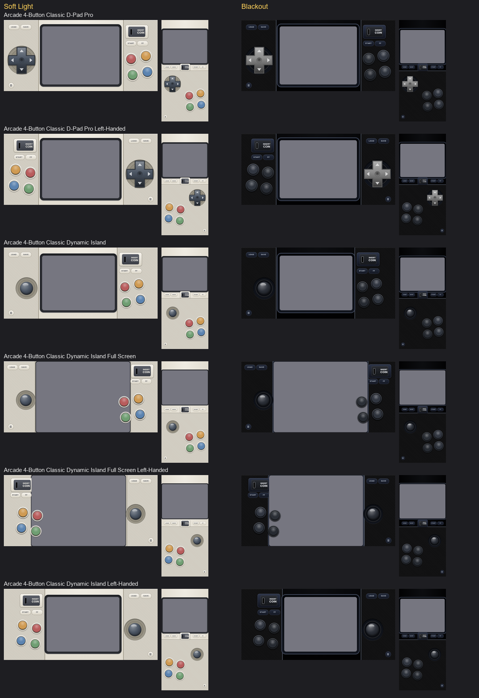
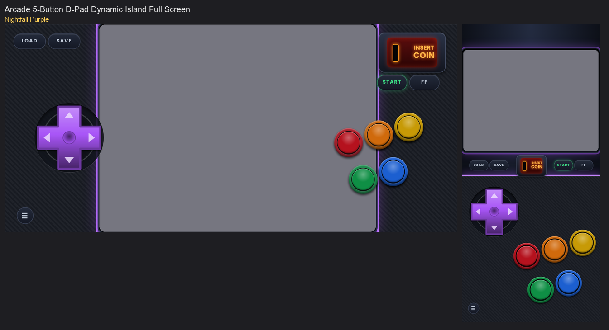

# Skin tools

Two small helper scripts for people making Manic EMU controller skins. They only read your skins and never change them.

| File | What it does |
|---|---|
| `check_skin.py` | Sanity check: valid zip, `info.json`, every referenced file present, inputs, canvas bounds, duplicate identifiers. |
| `contact_sheet.py` | Draws skins into pictures so you can compare layouts and colours by eye (phones and iPads). |
| `FORMAT_NOTES.md` | Notes on the skin format and the button numbering. |
| `contact_sheet_easy.py` | Same as contact_sheet.py, but simplified to run all colours every time unless specified otherwise. |

Both need Python 3 and Pillow (`pip install pillow`). `contact_sheet.py` draws the real button artwork if you also install PyMuPDF (`pip install pymupdf`); without it the artwork is drawn as outlines.

**Also if you try and run these on folders with spaces and manicskins with spaces in the name it will fail to find the skin, they look for folder names as 1 word and its case sensitive. So if you try and run  `python contact_sheet_easy.py Purple skin folder --colours all` it will fail because of the space in the folder name. It needs to read like this or similar `Python contact_sheet_easy.py Purple_skin_folder --colours all ` and the folder it's self needs to be named like that, it can be any name you like but it needs -_. something besides spaces.**

It can also run `.deltaskins`, All you have to do is change the extension of the `.deltaskin` to `.manicskin` and run the contact sheet with the manic extension like above. then change the extension back to `deltaskin` since `manicskin` is a extension of deltas.

```
python check_skin.py my_skins_folder
python contact_sheet.py my_skins_folder --colours "Blackout,Soft Light"
python contact_sheet_easy.py .
```

Run either with `--help` for all options. For a mixed folder (different layouts and colours), add `--compact` to `contact_sheet.py` to leave out empty slots. 

These tools are generic. They do not know the naming, colour or button-count rules of any particular collection.

## Preview
Running `contact_sheet.py` over a folder of skins writes numbered pictures to `contact_sheets/`:




<details>
<summary><b>More Sheet Examples </b></summary>

<br> 

**Sheet 1**


**Sheet 2**



**Sheet 3**


**Sheet 4**


**Sheet 5**


**Sheet 6**


</details>
Released under the MIT License, provided as-is with no warranty. The skins themselves are CC BY 4.0.
